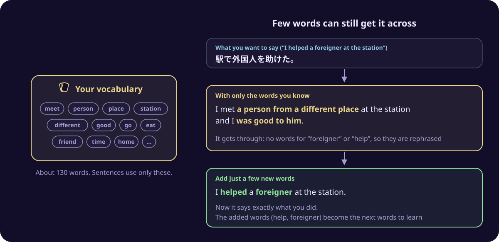
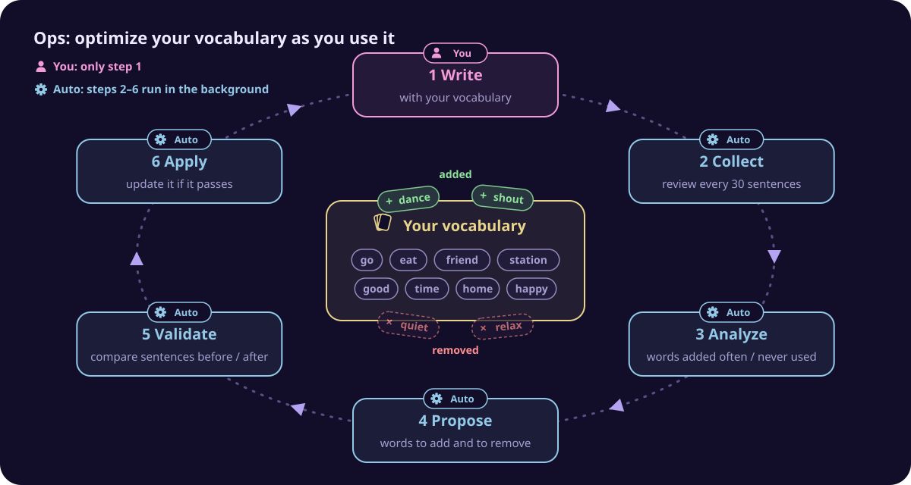

<p align="center">
  
</p>

<p align="center"><a href="README.md">日本語</a> | English</p>

vocabOps sets aside a small number of words as your own vocabulary for speaking a foreign language, and helps you say what you want with only those words. This vocabulary is optimized automatically to match what you wanted to say.

All you do is type what you want to say, in Japanese or another language. The app returns two sentences in the foreign language. One uses only your vocabulary. The other adds just a few words that are not in your vocabulary. Comparing the two shows how far your current vocabulary takes you, and which words would let you say it more precisely.


The app's screens, and the translations and notes it writes, are in Japanese.

## You understand a language, but cannot speak it

Vocabulary in a foreign language comes in two kinds:

- **Receptive vocabulary**: words whose meaning you understand when you hear or read them
- **Productive vocabulary**: words you can use yourself when you speak or write

Studies of learners show that productive vocabulary is smaller than receptive vocabulary, and that the gap is larger for less common words [1]. Productive vocabulary also grows more slowly than receptive vocabulary, and the gap widens as receptive vocabulary grows [2].

In other words, learning more words from a word list does not give you the same number of new words that come out when you speak. So, can you not speak while you can use only a few words?

## Few words can still get it across

You do not need to know every word to speak. Even if you know only a few words, rephrasing with them gets most of your meaning across. For English, "Basic English", a way of expressing things with only 850 words, was published as early as 1930 [3].

For example, say you want to say "I helped a foreigner at the station". Even if you do not know "foreigner" or "help", you can say "I met a person from a different place at the station and I was good to him", and the main point gets through. If you then add two words, foreigner and help, you can say exactly what you did. These two words become candidates for the next words to learn.



The app is built on this idea. It sets aside a small number of words as your own vocabulary for speaking, and first helps you say things with only those words. Then it adds the words you needed where rephrasing did not get your meaning across.

## What the app does

The app keeps "your vocabulary" for each language. In every language, it starts with about 130 basic words, and sentences are written only within this vocabulary. Grammar words such as "a" and "the" are always available on top of that. The screen calls this vocabulary 手札語彙 ("the cards in your hand").

- When you type what you want to say, it writes two sentences:
  - one with only your vocabulary (the screen calls it 手札語彙文)
  - one with your vocabulary plus a few words that are not in it (the screen calls it 拡張語彙文)
- Each sentence comes with a Japanese translation of what it actually says, and a note on what was rephrased and how.
- Tap a word in a sentence to hear it read aloud.
- English, French and Italian are supported.

## Optimizing your vocabulary automatically: Ops

Your vocabulary is reviewed automatically, based on what you have typed. The app calls this review system Ops.

Ops stands for operations. In software, approaches such as DevOps and MLOps do not stop once something is built: they keep it running, measure the results, and keep improving it. The app applies the same idea to your vocabulary.



The only thing you do is step 1, writing sentences. Steps 2 to 6 run automatically in the background.

You still decide what happens to the size of your vocabulary. On the settings screen, you choose for each language whether your vocabulary should grow, stay the same size, or shrink, and how many words change in one review (3 to 5).

**What you do**

1. **Write**: type what you want to say and get your sentences. Each time, the words added from outside your vocabulary in the second sentence, and the words in your vocabulary that were actually used, are recorded automatically.

**What runs automatically in the background** (for each language, every 30 sentences)

2. **Collect**: after 30 sentences, a review of your vocabulary starts.
3. **Analyze**: words that were often added from outside your vocabulary in your recent second sentences become candidates to add. On the other hand, words that are in your vocabulary but have not been used in your sentences for a long time are treated as words you do not need when you speak, and become candidates to remove. An AI ranks the candidates to add by how useful they are for speaking.
4. **Propose**: the app picks the words to add and to remove.
5. **Validate**: when the proposal both adds and removes words, the app checks whether the update really makes things better. Using 30 things you said before, it writes sentences with the current vocabulary and with the updated vocabulary, and asks an AI which ones convey the original meaning better. The proposal passes only when the sentences do not get worse overall.
6. **Apply**: only a proposal that passes is actually applied to your vocabulary. Later sentences use the new vocabulary.

The Ops screen shows how the size of your vocabulary has changed and the record of past reviews.


For each review, you can see which words were added and removed, and how each sentence changed during validation. In the example below, 8 words such as very, little and hour were added, and 4 words such as hello and help, which had not been used for a long time, were removed.


## Running it

vocabOps is a personal app that runs only on your own computer. It is not exposed to the internet (it listens on 127.0.0.1).

Sentences are written by DeepSeek V4.1 Flash through [OpenRouter](https://openrouter.ai/). Each sentence costs about 0.1 to 0.2 yen (a small fraction of a US cent). Each review of your vocabulary costs a few yen.

### Requirements

- Node.js 26 or later
- An OpenRouter API key

### Setup

```bash
git clone <this repository's URL>
cd vocab-ops
npm install
```

Create `.env.local` in the repository root and put your OpenRouter API key in it (`.env.local` is not tracked by Git).

```
OPENROUTER_API_KEY=sk-or-...
```

Import the starting vocabulary for each language.

```bash
npm run import-baseline -- en
npm run import-baseline -- fr
npm run import-baseline -- it
```

### Start

Use two terminals and start these two processes.

```bash
npm run dev      # the screens
npm run worker   # writes sentences and reviews your vocabulary in the background
```

Open the URL that `npm run dev` prints in the terminal. Data is stored in `data/vocab.db`.

## More documents (in Japanese)

| Document | Contents |
|---|---|
| [Screens and terms](docs/screens-and-terms.md) | What each screen does, what the words on the screens mean, and the commands |
| [Planned improvements](docs/improvements.md) | Things found while using the app that should be improved |
| [Design documents](docs/00-overview.md) | Background, goals, architecture, data model, and how the reviews work (in `docs/`) |

## References

1. Webb, S. (2008). Receptive and productive vocabulary sizes of L2 learners. *Studies in Second Language Acquisition*, 30(1), 79–95.
   Measured how many words learners understand and how many they can use, with tests in the same format. Learners could use fewer words than they understood, and the gap was larger for less common words.
2. Laufer, B., & Paribakht, T. S. (1998). The relationship between passive and active vocabularies: Effects of language learning context. *Language Learning*, 48(3), 365–391.
   Reported that the words learners can use grow more slowly than the words they understand, and that the gap widens as the words they understand increase.
3. Ogden, C. K. (1930). *Basic English: A General Introduction with Rules and Grammar*. London: Kegan Paul.
   Proposed "Basic English", English limited to 850 words. An early example of the idea of expressing yourself with a limited set of words.
