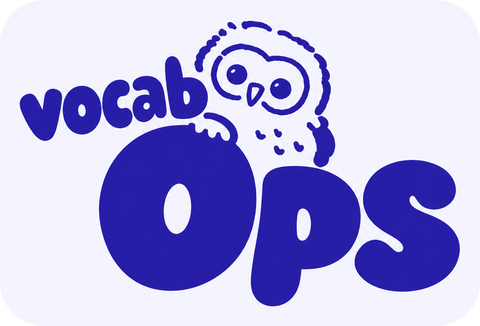
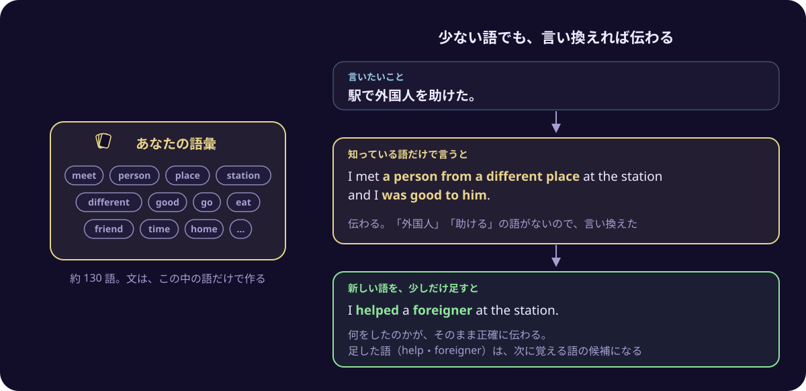
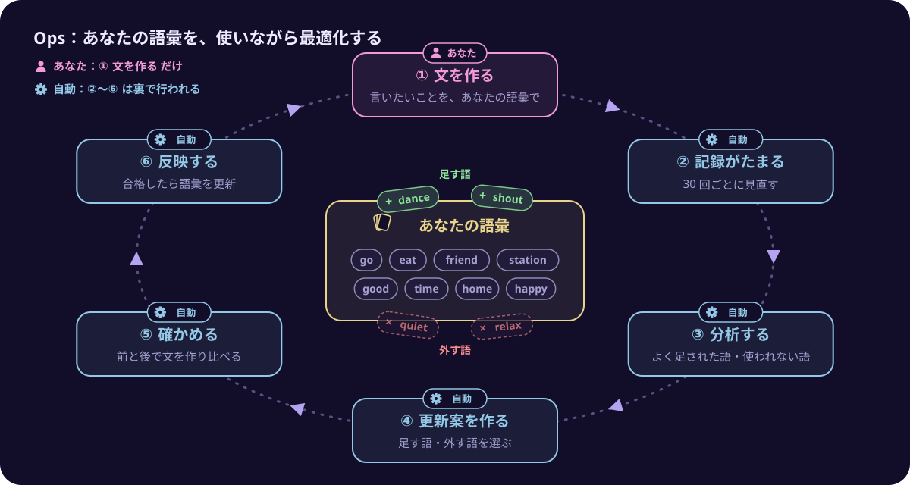

<p align="center">
  
</p>

<p align="center">日本語 | <a href="README.en.md">English</a></p>

外国語で話すときに使う語を、あなた専用の語彙として少ない数に決めておき、その語だけで言いたいことを言えるようにするアプリです。この語彙は、あなたが言いたかったことに合わせて、自動で最適化されていきます。

使い方は、言いたいことを日本語で入れるだけです。すると、2つの外国語の文が返ってきます。1つは、あなたの語彙だけで作った文です。もう1つは、あなたの語彙にない語を数語だけ足して作った文です。2つの文を見比べると、今の語彙でどこまで言えるのか、どの語を覚えればもっと正確に言えるのかが分かります。


## 外国語は「わかる」のに「話せない」

外国語の語彙には、2つの種類があります。

- **受容語彙**：聞いたり読んだりしたときに、意味が分かる語
- **産出語彙**：自分で話したり書いたりするときに、使える語

学習者を調べた研究では、使える語（産出語彙）は、わかる語（受容語彙）よりも少ないことが分かっています。あまり使われない語ほど、その差は大きくなります[1]。また、使える語はわかる語よりもゆっくりとしか増えず、わかる語が増えるほど、2つの差は広がっていくという報告もあります[2]。

つまり、単語帳で覚えた語が増えても、話すときに口から出てくる語が同じだけ増えるわけではありません。では、使える語が少ないうちは、話せないのでしょうか。

## 少ない語でも、言い換えれば伝わる

話すために、すべての語を知っている必要はありません。知っている語が少なくても、その語で言い換えれば、多くのことは伝えられます。英語では、使う語を 850 語にしぼって表現する「Basic English」という試みが、1930 年に発表されています[3]。

たとえば「駅で外国人を助けた。」と言いたいとします。「外国人」や「助ける」にあたる語を知らなくても、「違う場所から来た人に会って、親切にした」と言い換えれば、話の中身は伝わります。そのうえで foreigner と help の2語を足すと、何をしたのかが、そのまま正確に伝わります。この2語は、次に覚える語の候補になります。



このアプリは、この考え方にもとづいて作っています。話すときに使う語を、あなた専用の語彙として少ない数に決めておき、まずはその語だけで言えるようにします。そして、言い換えではうまく伝わらなかったところで必要になった語を、語彙に足していきます。

## このアプリでできること

このアプリは、言語ごとに「あなたの語彙」を持っています。どの言語も、最初は基本的な語の約 130 語から始まり、文はこの語彙の中だけで作ります。このほかに、a や the のような文法のための語は、いつでも使えるようになっています。画面では、この語彙を「手札語彙」（手札＝手持ちのカード）と呼んでいます。

- 言いたいことを日本語で入れると、次の2つの文を作ります。
  - あなたの語彙だけで作った文（画面では「手札語彙文」と呼んでいます）
  - あなたの語彙に、語彙にない語を数語まで足して作った文（画面では「拡張語彙文」と呼んでいます）
- それぞれの文に、実際に伝わる意味の日本語訳と、何をどう言い換えたかの説明が付きます。
- 文の中の語をタップすると、読み上げます。
- 英語・フランス語・イタリア語に対応しています。

## あなたの語彙を、自動で最適化する：Ops

あなたの語彙は、あなたが入れた言いたいことをもとに、自動で見直されます。この見直しの仕組みを、このアプリでは Ops と呼んでいます。

Ops は operations（運用）の略です。ソフトウェアの開発では、DevOps や MLOps のように、作って終わりにせず、動かしながら結果を測り、直し続けるやり方をこう呼びます。このアプリでは、この考え方を、あなたの語彙に当てはめています。



あなたがするのは、① の文を作ることだけです。② から ⑥ は、アプリが裏で自動で行います。

ただし、語彙の数をどうするかは、あなたが決められます。設定の画面で、言語ごとに、語彙を「増やす」「変えない」「減らす」のどれにするかと、1回の見直しで変える語数（3〜5 語）を選んでおきます。

**あなたがすること**

1. **文を作る**：言いたいことを入れて、文を作ります。そのたびに、2つ目の文で語彙の外から足された語と、語彙の中の語のうち実際に使われた語が、自動で記録されます。

**裏で自動で行われること**（言語ごとに、文を 30 回作るたびに）

2. **記録がたまる**：文を 30 回作ると、語彙の見直しが始まります。
3. **分析する**：最近の2つ目の文で、語彙の外からよく足された語を「足す候補」にします。反対に、語彙にあっても、あなたの文で長い間使われていない語は、あなたが話すときには必要のない語と考えて「外す候補」にします。足す候補には、AI が、話すときに役に立つ順に順位を付けます。
4. **更新案を作る**：足す語と外す語を選びます。
5. **確かめる**：足す語と外す語の両方があるときは、更新したほうが本当に良くなるかを確かめます。過去に入れた言いたいこと 30 件で、今の語彙と更新後の語彙のそれぞれで文を作り、どちらが元の意味をよく伝えているかを AI に比べさせます。全体として文が悪くならないと確かめられたときだけ、合格になります。
6. **反映する**：合格した更新案だけが、実際にあなたの語彙に反映されます。それからあとの文は、新しい語彙で作られます。

Ops の画面では、語彙の数の移り変わりと、これまでの見直しの記録を見られます。


見直しの1回ごとに、どの語を足して、どの語を外したかを見られます。確かめたときに、どの文がどう変わったかも見られます。下の例では、very・little・hour など 8 語を足し、hello・help など、長い間使われていなかった 4 語を外しました。


## 動かし方

このアプリは、自分のパソコンだけで動かす個人用のアプリです。インターネットには公開しません（127.0.0.1 で待ち受けます）。

文は、[OpenRouter](https://openrouter.ai/) を通して DeepSeek V4.1 Flash で作ります。費用は、文を1回作るごとに約 0.1〜0.2 円です。語彙の見直しには、1回あたり数円かかります。

### 必要なもの

- Node.js 26 以上
- OpenRouter の API キー

### 準備

```bash
git clone <このリポジトリの URL>
cd vocab-ops
npm install
```

リポジトリの直下に `.env.local` を作り、OpenRouter の API キーを書きます（`.env.local` は Git に入りません）。

```
OPENROUTER_API_KEY=sk-or-...
```

言語ごとに、最初の語彙を取り込みます。

```bash
npm run import-baseline -- en
npm run import-baseline -- fr
npm run import-baseline -- it
```

### 起動

ターミナルを2つ使い、次の2つを起動します。

```bash
npm run dev      # 画面
npm run worker   # 文を作る処理と、語彙の見直しを、裏で行う
```

画面は、`npm run dev` を起動したときにターミナルに出る URL で開けます。データは `data/vocab.db` に保存されます。

## 詳しい資料

| 資料 | 内容 |
|---|---|
| [画面と用語](docs/screens-and-terms.md) | 画面ごとにできること、画面に出てくる言葉の意味、コマンドの一覧 |
| [今後の改善点](docs/improvements.md) | 動かしてみて分かった、直したほうがよい点 |
| [設計の資料](docs/00-overview.md) | 背景、目的、部品の分け方、データの設計、見直しの仕組み（`docs/` の中） |

## 参考文献

1. Webb, S. (2008). Receptive and productive vocabulary sizes of L2 learners. *Studies in Second Language Acquisition*, 30(1), 79–95.
   外国語の学習者について、わかる語と使える語の数を、同じ形式のテストで測った研究です。使える語はわかる語より少なく、あまり使われない語ほど、その差が大きいことを示しました。
2. Laufer, B., & Paribakht, T. S. (1998). The relationship between passive and active vocabularies: Effects of language learning context. *Language Learning*, 48(3), 365–391.
   使える語は、わかる語よりもゆっくりとしか増えず、わかる語が増えるほど、2つの差が広がることを報告した研究です。
3. Ogden, C. K. (1930). *Basic English: A General Introduction with Rules and Grammar*. London: Kegan Paul.
   使う語を 850 語に絞った英語「Basic English」を提案した本です。限られた語で表現するという考え方の、古くからの例です。
