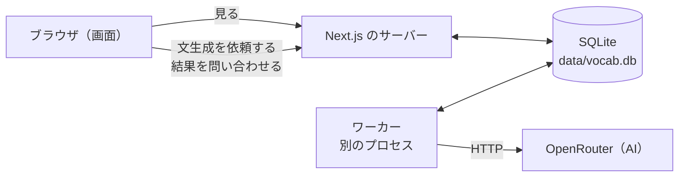
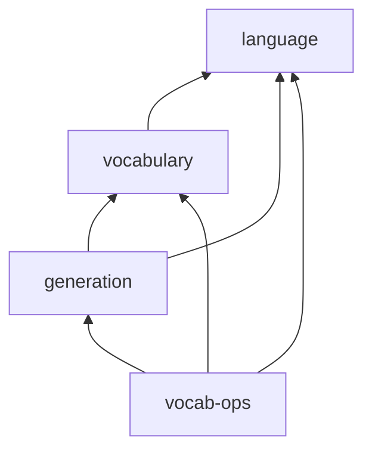

# アーキテクチャ

作成日：2026-10-18　状態：下書き

このアプリを、どの部品に分け、部品どうしがどうつながり、どの道具で作るかをまとめた文書。用語は `00-overview.md` の用語集に従う。DB の表の形は `02-data-model.md` に書く。

## 1. 全体の構成

このアプリでは、次の3つが動く。

| 動くもの | 役割 |
|---|---|
| ブラウザ（画面） | 語彙一覧や履歴を表示する。文生成の依頼を受け付け、結果ができたかを問い合わせる |
| Next.js のサーバー | 画面を作って返す。画面からの依頼（文生成の依頼など）を受け付けて、DB に書き込む |
| ワーカー（裏で処理する係） | Next.js とは別のプロセスとして動く。DB を見て、まだ処理されていない文生成と語彙更新を見つけ、1つずつ処理する |

DB は SQLite のファイル1つで、Next.js のサーバーとワーカーの両方がこのファイルを読み書きする。AI（OpenRouter）を呼ぶのはワーカーだけである。



### 時間のかかる処理を、ワーカーに任せる理由

文生成は1回に十数秒かかる。画面がその間ずっと待つと、次の入力ができない（旧版の課題）。そこで、画面からの依頼は DB に書くだけにして、すぐに返事をする。実際の処理はワーカーが裏で行う。語彙更新は、追加候補の順位付けや語彙更新検証で AI を何度も呼ぶので、さらに時間がかかる。これもワーカーが行う。

## 2. 処理の流れ

### 文生成

1. ユーザーが画面で言いたいことを入力して送信する。
2. Next.js のサーバー（API）は、文生成の表に1行を書き、その行の状態を「待ち」にする。そして、その行の番号をすぐ画面に返す。
3. ワーカーは、状態が「待ち」の文生成を見つけ、状態を「実行中」にする。このとき、その言語の今の手札語彙と、その版を読み込んで確定する。この文生成では、最後までこの手札語彙を使う（下の「手札語彙の一貫性」）。そのあと AI を呼ぶ。
4. AI の返事を採点し、条件を満たさなければ作り直させる。
5. 結果（手札語彙文・拡張語彙文・それぞれの語）を DB に書き、状態を「完了」にする。うまくいかなければ「失敗」にする。
6. 画面は2秒おきに、その番号の文生成の状態を問い合わせ、「完了」になったら結果を表示する。

### 語彙更新

1. ワーカーは、文生成を1件完了するたびに、その言語で前回の語彙更新から何回の文生成があったかを確かめる。
2. 決められた回数（`vocab-ops/parameters.md`）に達していたら、語彙更新の表に1行を書き、状態を「待ち」にする。
3. ワーカーは、状態が「待ち」の語彙更新を見つけて処理する（中身は `vocab-ops/` の設計どおり）。
4. 結果を DB に書き、状態を「完了」または「失敗」にする。

### 手札語彙の一貫性

1つの文生成の途中で、手札語彙が別の版に変わってしまうと、文を作るときと採点するときで違う手札語彙を使うことになり、結果が狂う。これを防ぐために、次の決まりを守る。

1. **文生成は、始めるときに使う手札語彙とその版を確定し、最後まで同じ手札語彙を使う。** 途中で語彙更新が手札語彙を新しい版にしても、その文生成は最初に読み込んだ版のまま完了する。文生成の記録には、使った版を残す（`02-data-model.md` の `generations.active_vocab_version`）。
2. **語彙更新を手札語彙に反映するときは、1つのトランザクションの中でまとめて行う。** 語の状態の変更、出入りの履歴の追加、手札語彙の版を進めることを、すべてまとめて書き込む。ほかの処理が、一部の語だけ変わった途中の状態を読むことはない。
3. **語彙更新検証で文を作るときも、使う手札語彙を最初に確定する。**

こうしておけば、文生成と語彙更新が同時に動いても、手札語彙が途中で混ざることはない。最初の実装ではワーカーは1つで、仕事を1件ずつ順に処理するが、**データの整合性は、ワーカーの数や処理の順番に頼らず、上の決まりで守る。** 将来ワーカーを増やしたり、仕事を同時に処理したりしても、この決まりのままで安全である。

## 3. ソースコードの分け方

全体は、1つの Next.js のアプリ（モジュラーモノリス）にする。中は、機能ごとのフォルダに分ける。

```
src/
  app/                  画面と API の入口。URL ごとのフォルダ。中身は features を呼ぶだけにする
  worker/               ワーカーの入口。features を呼んで、待ちの仕事を1つずつ処理する
  cli/                  コマンドの入口（ベースラインの取り込みなど）。引数を受け取って features を呼び、結果を表示するだけにする
  features/
    language/           言語ごとの規則（辞書形の正規化、表記ゆれの吸収、語の判定、文法の注意）
    vocabulary/         手札語彙・ノーカン語彙・言語の設定の読み書き、手札語彙の版と出入りの履歴、ベースラインの取り込み
    generation/         手札語彙での文生成（プロンプト、AI の呼び出し、採点、作り直し、履歴の記録）
    vocab-ops/          語彙更新（追加候補、削除候補、更新案、語彙更新検証、反映、記録）
  shared/               業務の知識を持たない共通の道具（DB への接続とマイグレーションの実行、環境変数の読み込み、OpenRouter を呼ぶ土台、共通の画面部品）
db/
  migrations/           DB の表を作る・変える SQL ファイル（番号つき）
data/
  vocab.db              DB のファイル（git には入れない）
```

### 機能どうしの依存の向き

矢印は「呼ぶ（import する）」向き。逆向きの矢印は作らない。どの機能も `shared/` を使ってよいが、`shared/` はどの機能も使わない。



- **language** は、ほかのどの機能にも依存しない。言語の規則はこのアプリの中心となる知識なので、一番内側に置く。
- **vocabulary** は、手札語彙とノーカン語彙の持ち主である。手札語彙を変えるときは、ほかの機能もこの機能の窓口を通して頼む。語彙の表を直接書き換えない。
- **generation** は、文生成の持ち主である。文生成の履歴を読むときは、ほかの機能もこの機能の窓口を通す。
- **vocab-ops** は、generation の窓口から履歴を読み、vocabulary の窓口に手札語彙の変更を頼む。語彙更新検証で文を作るときも、generation の窓口を使う。

### 守る決まり

一人で作るので、道具を使って機械的に禁止することはしない。次の決まりを文書に残し、コードを読むときに確かめる。

1. **機能の規則を書いたファイル（DB も AI も使わない関数）は、DB への接続や fetch を import しない。** DB や AI なしで単体テストできるようにするため。
2. **ほかの機能のものは、その機能の `index.ts`（窓口）からだけ使う。** 機能の中身を変えても、窓口が同じならほかの機能が壊れないようにするため。
3. **SQL を書くのは、各機能の DB とのやりとりを受け持つファイルだけにする。**
4. **外から来た値は、使う前に必ず zod で形を確かめる。** 外から来た値とは、画面からの入力、AI の返事の JSON、DB から読んだ行のこと。
5. **名前は `00-overview.md` の用語集に合わせる。** 用語集にない名前が必要になったら、先に用語集に足す。

## 4. 道具の決定

| 決めたこと | 内容 | 理由 |
|---|---|---|
| ワーカーの動かし方 | Next.js とは別のプロセスとして動かす（例：`npm run worker`） | 開発中に Next.js がコードを自動で読み込み直しても、裏の処理が二重に動かない。画面を返す係と裏で処理する係がはっきり分かれ、仕組みを説明しやすい。起動するコマンドは2つになる |
| 待ちの仕事の持ち方 | 文生成の表と語彙更新の表に、それぞれ状態の列（待ち・実行中・完了・失敗）を持たせる。仕事専用の表は作らない | 裏で処理する仕事は文生成と語彙更新の2種類だけなので、それぞれの記録に状態を持たせれば足りる。記録と状態が1か所にまとまる |
| 画面とサーバーのやりとり | 表示するだけの画面は、サーバー側で動く画面の部品から機能の窓口を直接呼んでデータを読む。文生成の依頼や状態の問い合わせなど、何かを頼むものは API（`route.ts`）にする | 読むだけのために API を作らずに済む。Next.js 公式の案内も、サーバー側の部品からデータを読む形を勧めている |
| DB の道具 | Node.js に組み込まれている `node:sqlite` を使い、SQL を直接書く。表の作成と変更は、番号つきの SQL ファイル（マイグレーション）で管理する | SQL がそのまま見えるので、DB に何を頼んでいるかが分かる。ライブラリを増やさない。DB から読んだ値の型は、窓口で zod を使って付ける |
| AI の呼び方 | `fetch` で OpenRouter の HTTP API を直接呼ぶ | ライブラリを増やさない。送る中身と返ってくる中身が、そのまま見える |
| 外から来た値の検証 | zod を使う | データの形を一度書くと、検証と TypeScript の型の両方が得られる。旧版の「壊れた JSON を送ると 500 が返る」問題を防ぐ |
| テスト | Node.js に組み込まれている `node:test` を使う。実行には下の `tsx` を使う | ライブラリを増やさない。言語の規則のような関数のテストには十分 |
| Next.js の外で TypeScript を動かす道具 | `tsx` を使う。ワーカー、ベースラインの取り込みのコマンド、テストは `tsx` で動かす | Next.js の画面と同じ書き方（`@/` で始まる import、拡張子を省いた import）のまま、同じコードを Next.js の外でも動かせる。Node.js だけで動かす場合は、すべての import に拡張子を付け、`@/` の代わりに Node.js 独自の書き方を使う必要があり、普通の Next.js のコードと見た目が変わってしまう |
| 画面の部品の置き場所 | その画面でしか使わない部品（入力欄など）は、その画面のフォルダ（例：`src/app/generate/`）に、ページのファイルと並べて置く。複数の画面で使う部品のうち、業務の知識を持たないもの（国旗など）は `src/shared/ui/` に置く。文生成の結果のカードのように、業務の知識を持ちつつ複数の画面で使う部品は、元の画面のフォルダに置いたまま、ほかの画面からそこを使う | 部品とそれを使う画面が近くにあり、探しやすい。Next.js の公式の案内でも勧められている置き方 |
| 画面の見た目（CSS） | CSS Modules を使う。画面の部品ごとに CSS ファイルを隣に置く。色・パネル・ボタンなど全画面に共通の見た目だけは `src/app/globals.css` に置く。配色とフォント（Quicksand、M PLUS Rounded 1c）は旧版に合わせる | Next.js に最初から入っている。部品ごとに名前がぶつからず、旧版の「1つの CSS ファイルに1,000行」を防ぐ |

ほかに、`00-overview.md` で決めた技術（Next.js の App Router、TypeScript、SQLite、OpenRouter）と動作環境（ローカル環境、127.0.0.1 で待ち受ける）は、そのまま使う。

## 5. 起動と設定

- 開発中は、Next.js のサーバー（`npm run dev`）とワーカー（`npm run worker`）の2つを起動する。
- OpenRouter の API キーは、環境変数 `OPENROUTER_API_KEY` として `.env.local` に書く。`.env.local` は git に入れない。
- DB のファイル（`data/vocab.db`）は git に入れない。
- 環境変数 `VOCAB_OPS_DATABASE_PATH` を指定すると、`data/vocab.db` の代わりにそのファイルを DB として使う。本物の DB を書き換えずに、写しで動作を試すときに使う。
- アプリとワーカーは、起動するときにまだ実行していないマイグレーションの SQL ファイルを、番号の順に実行する。

## 6. 未決

- ワーカーが一度に処理する仕事の数。まずは1つのワーカーで、1件ずつ順に処理する。手札語彙の一貫性は、処理の数ではなく「手札語彙の一貫性」の決まりで守るので、あとから増やすこともできる。
- 語彙更新の数値（`vocab-ops/parameters.md`）を、コードの設定ファイルに置くか、DB に置くか。
