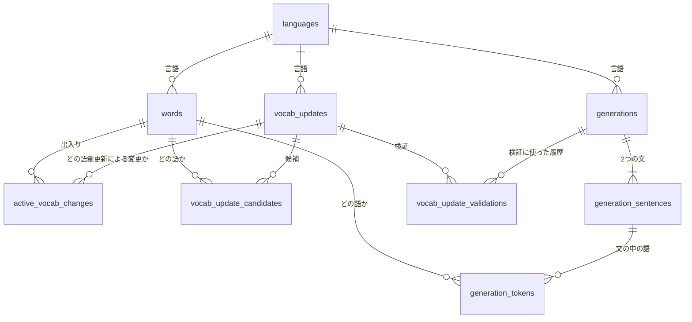

# データの設計（DB の表）

作成日：2026-10-18　状態：下書き

DB（SQLite）にどんな表を作り、それぞれの表に何を記録するかをまとめた文書。用語は `00-overview.md` の用語集に従う。何を記録する必要があるかは、`vocab-ops/01-history.md` と `vocab-ops/06-update-log.md` から決めている。

表の作成と変更は、`db/migrations/` の番号つきの SQL ファイル（マイグレーション）で行う。コードを書く段階からは、その SQL ファイルが表の形の正（本物）になり、この文書は「なぜこの形なのか」を説明する役割になる。

## 1. 表の一覧

| 表 | 内容 |
|---|---|
| `languages` | 言語ごとの設定と、言語ごとの数（今の手札語彙の版、最後の文生成の通し番号など） |
| `words` | 語。手札語彙の語、ノーカン語彙の語、手札外語彙の語（拡張語彙文に出てきた語や、手札語彙から外れた語）を、1つの語につき1行で持つ |
| `active_vocab_changes` | 手札語彙の出入りの履歴。語が手札語彙に入った・外れたという出来事を1回ごとに1行 |
| `generations` | 文生成。1回の依頼が1行。状態の列が、ワーカーの待ち行列を兼ねる |
| `generation_sentences` | 文生成で作った文。1回の文生成につき、手札語彙文と拡張語彙文の2行 |
| `generation_tokens` | 文生成で作った文に出てくる語。1語が1行 |
| `vocab_updates` | 語彙更新。1回の実行が1行。状態の列が、ワーカーの待ち行列を兼ねる |
| `vocab_update_candidates` | 語彙更新で出した追加候補と削除候補。更新案に入れたかどうかも、ここに記録する（更新案専用の表は作らない） |
| `vocab_update_validations` | 語彙更新検証で比べた文と、その比較判定 |
| `schema_migrations` | どのマイグレーションを実行したかの記録 |

## 2. 表どうしのつながり

## 3. 表ごとの中身

列の名前と型は、コードを書く段階で SQL にするときに見直す。SQLite には真偽値の型がないので、真偽値は 0 と 1 で表す。日時は ISO 8601 形式の文字列（例：`2026-10-18T17:00:00Z`）で持つ。

### 3.1 `languages`（言語の設定）

| 列 | 内容 | 理由 |
|---|---|---|
| `code` | 言語コード（`en`・`fr` など）。この表の主キー | 言語は ISO 639-1 のコードで表すと決めているため |
| `vocab_size_mode` | 増減モード（`increase`・`keep`・`decrease`） | 言語ごとにユーザーが選び、変えるまで保持するため |
| `voice_name` | 読み上げに使う声の名前。空なら自動で選ぶ | 言語ごとに声を選べるようにするため |
| `expanded_outside_word_limit` | 拡張語彙文で使ってよい手札外語彙の語の数の上限 | 設定で変えられるようにするため |
| `active_vocab_version` | 今の手札語彙の版 | 手札語彙が変わるたびに1つ進める |
| `last_generation_seq` | その言語で最後に受け付けた文生成の通し番号 | 次の文生成に通し番号を振るため |
| `last_vocab_update_seq` | 最後に語彙更新を始めたときの、文生成の通し番号 | 前回の語彙更新から何回の文生成があったかを数えるため |

言語ごとの規則（文法の注意、表記ゆれの吸収など）は、この表には置かない。テストと一緒に直すべきものなので、`features/language` のコードに置く。

言語の行は、その言語のベースラインを初めて取り込むときに作る（5章）。行を作ったときの値は次のとおり。

- 増減モード（`vocab_size_mode`）は `increase` にする。最初は手札語彙を増やす方向で使い始める。あとで画面から変えられる。
- 拡張語彙文で使ってよい手札外語彙の語の数の上限（`expanded_outside_word_limit`）は 5 にする（`vocab-ops/parameters.md`）。
- 手札語彙の版と、2つの通し番号は 0 にする。手札語彙の版は、ベースラインの手札語彙を取り込んだときに1になる。

### 3.2 `words`（語）

手札語彙の語、ノーカン語彙の語、手札外語彙の語を、1つの表で持つ。どれにあたるかは `vocab_status` の列で区別する。

**手札外語彙の語**とは、手札語彙にもノーカン語彙にも入っていない語のことである。次の2種類がある。

- 拡張語彙文に初めて出てきた語。出てきた時点で、この表に手札外語彙の語として登録する。
- 手札語彙から外れた語。行は消さず、手札外語彙の語に戻す。

例：イタリア語で `chiedere`（尋ねる）が拡張語彙文に初めて出てきたとき、この表は次のようになる。

| 語 | 状態 |
|---|---|
| `dire`（言う） | 手札語彙 |
| `essere`（〜である） | ノーカン語彙 |
| `chiedere`（尋ねる） | 手札外語彙 |

のちに `chiedere` が語彙更新で手札語彙に足されたら、同じ行の状態を「手札語彙」に変える。語の番号（`id`）は変わらないので、文生成の履歴や追加候補との関連付けがそのまま使い続けられる。

| 列 | 内容 | 理由 |
|---|---|---|
| `id` | 語の番号 | 文生成の結果の語、追加候補・削除候補、手札語彙の出入りの履歴から、この番号で語を指す |
| `language` | 言語コード | |
| `lemma` | 辞書形（表示用。大文字小文字やアクセントはそのまま） | 画面に表示するため |
| `lemma_key` | 正規化した辞書形（小文字にそろえるなど。規則は `features/language`） | 同じ語を2回登録しないため。旧版では大文字小文字の違いで同じ語が2回入る問題があった |
| `meaning` | 日本語の意味。空でもよい | 手札語彙の語は、ベースラインの「意味」の列の値を入れる。ノーカン語彙の語は、ベースラインに意味の列がないので空にする。手札外語彙の語は、文生成で AI が付けた意味を入れ、その語が出てくるたびに最新の値に更新する |
| `part_of_speech` | 品詞。空でもよい | 手札語彙の語は、ベースラインの品詞の見出しを入れる。ノーカン語彙の語は、ベースラインの「種類」の列の値（冠詞、接続詞など）を入れる。手札外語彙の語は、意味と同じく、文生成で AI が付けた値で更新する |
| `vocab_status` | `active`（手札語彙）・`uncounted`（ノーカン語彙）・`outside`（手札外語彙） | 1つの表で3種類を持つため |
| `added_version` | 今回、手札語彙に入ったときの版（手札語彙の語だけ） | 履歴の表をたどらなくても、すぐ分かるようにするため |
| `added_generation_seq` | 今回、手札語彙に入ったときの、その言語の文生成の通し番号（手札語彙の語だけ） | 「手札語彙に入ってからの文生成回数」を計算するため。再び入ったときに書き換えるので、0から数え直す決まりにそのまま合う |
| `created_at` | この行を作った日時（語が初めて登録された日時） | |

- 同じ言語で、同じ `lemma_key` の行は1つだけにする。
- `added_version` と `added_generation_seq` は、`active_vocab_changes` に書いた最新の「入った」と同じ値になるよう、必ず同じトランザクションの中で書き換える。
- 手札語彙から外れた語は、`vocab_status` を `outside` にし、`added_version` と `added_generation_seq` は空にする。
- 固有名詞と算用数字（判定が固有名詞・数字の語）は、この表には登録しない。

### 3.3 `active_vocab_changes`（手札語彙の出入りの履歴）

語が手札語彙に入った、または外れたという出来事を、1回ごとに1行で残す。今の状態（`words`）だけでは過去の手札語彙が分からないので、この表で過去を再現できるようにする。

| 列 | 内容 | 理由 |
|---|---|---|
| `id` | 番号 | |
| `word_id` | どの語か | |
| `language` | 言語コード | 言語ごとに集計しやすくするため |
| `change` | `added`（入った）か `removed`（外れた） | |
| `version` | この変更を反映したあとの、手札語彙の版 | ある版の手札語彙を再現するため |
| `generation_seq` | この変更のときの、その言語の文生成の通し番号 | 入っていた期間を、文生成の回数で測るため |
| `source` | `baseline_import`（最初のベースラインの取り込み）か `vocab_update`（語彙更新） | 手札語彙が変わる経路はこの2つだけのため |
| `vocab_update_id` | どの語彙更新による変更か（ベースラインの取り込みなら空） | |
| `reason` | 変更の理由（追加候補の選定理由、削除候補の判定の根拠など） | |
| `created_at` | 日時 | |

ある版の手札語彙は、「その版までに入ったことがあり、その版の時点で最後の出来事が『入った』である語」として、この表から取り出せる。

`vocab_update_id` の列は、最初のマイグレーション（0001）では作らない。この列が指す `vocab_updates` の表がまだないためである。語彙更新を作る段階で、`vocab_updates` の表を作るマイグレーションの中で、この列を足す。

### 3.4 `generations`（文生成）

| 列 | 内容 | 理由 |
|---|---|---|
| `id` | 番号 | 画面が状態を問い合わせるときに使う |
| `language` | 言語コード | |
| `seq` | 言語ごとの通し番号（その言語で何回目の文生成か） | 語彙更新を何回の文生成ごとに行うか、各語が手札語彙に入ってから何回の文生成があったかを数えるため |
| `status` | 状態（`pending` 待ち・`running` 実行中・`done` 完了・`failed` 失敗） | ワーカーの待ち行列を兼ねるため |
| `message` | 言いたいこと（原文） | 語彙更新検証で、同じ原文から文を作り直すため |
| `situation` | 状況（空でもよい） | 同上 |
| `speaker` | 話し手の性別（`female`・`male`） | 同上 |
| `active_vocab_version` | 文生成したときの手札語彙の版 | 語彙更新検証で、保存済みの手札語彙文を使い回せるかを判断するため |
| `model` | 使った AI のモデル | 同上 |
| `prompt_version` | 使ったプロンプトの版 | 同上 |
| `expanded_outside_word_limit` | そのときの、拡張語彙文で使ってよい手札外語彙の語の数の上限 | 同上 |
| `cost_usd` | かかった費用（ドル） | 費用を集計するため |
| `error` | 失敗したときの理由 | |
| `created_at`・`started_at`・`finished_at` | 受け付けた日時、処理を始めた日時、終えた日時 | 待ち時間と処理時間を見るため |

- 同じ言語で同じ `seq` の行は1つだけにする。

### 3.5 `generation_sentences`（文生成で作った文）

1回の文生成につき、手札語彙文と拡張語彙文の2行を作る。

| 列 | 内容 | 理由 |
|---|---|---|
| `id` | 番号 | |
| `generation_id` | どの文生成の文か | |
| `sentence_type` | `current_set`（手札語彙文）か `expanded_set`（拡張語彙文） | |
| `sentence` | 外国語の文 | |
| `translation` | 実際の意味（日本語訳） | 元の言いたいことと比べるため。追加候補の順位付けで LLM に渡すため |
| `comment` | 言い換えた部分や失われたニュアンスを説明する日本語のコメント | 同上 |
| `attempts` | 採点に通るまでに AI に作らせた回数 | 作り直しがどれくらい起きているかを見るため |
| `unresolved_problems_json` | 作り直しの上限まで作らせても採点に通らなかったときの、残った問題（JSON）。通ったときは空 | 採点に通らなかった文も、問題が分かる形で残して画面に出すため |

### 3.6 `generation_tokens`（文に出てくる語）

| 列 | 内容 | 理由 |
|---|---|---|
| `id` | 番号 | |
| `sentence_id` | どの文の語か | |
| `position` | 文の中での順番 | 画面で、文の中の語に色を付けるため |
| `surface` | 表層形（文の中に実際に出てくる形） | 同上 |
| `word_id` | どの語か（`words.id`）。固有名詞・数字の語は空 | 追加候補・削除候補の集計で、語を番号で突き合わせるため |
| `lemma` | 辞書形（AI が返したまま） | 当時の記録として残すため |
| `meaning` | 辞書形の日本語の意味（AI が付けたもの） | 当時の記録として残すため。手札外語彙の語の意味（`words.meaning`）は、この値で更新する |
| `part_of_speech` | 品詞（AI が付けたもの） | 同上 |
| `judgement` | 判定（`active` 手札語彙・`uncounted` ノーカン語彙・`outside` 手札外語彙・`proper_or_number` 固有名詞・数字） | 文生成のときの手札語彙で判定した結果を残すため。あとで手札語彙が変わっても、当時の判定が分かる |

追加候補・削除候補の集計は、この表から行う（数え方は `vocab-ops/README.md` の「履歴の2つの使い道」）。

- 削除の判定用の使用：`judgement` が `active` の行。
- 追加候補用の出現：`sentence_type` が `expanded_set` の文の、`judgement` が `outside` の行。
- どちらも、同じ文生成の中では1回と数える。

### 3.7 `vocab_updates`（語彙更新）

| 列 | 内容 | 理由 |
|---|---|---|
| `id` | 番号 | |
| `language` | 言語コード | |
| `status` | 状態（`pending` 待ち・`running` 実行中・`done` 完了・`failed` 失敗） | ワーカーの待ち行列を兼ねるため |
| `trigger_generation_seq` | 語彙更新を始めたときの、その言語の文生成の通し番号 | どの履歴までを材料にしたかを残すため |
| `vocab_size_mode` | そのときの増減モード | |
| `version_before` | 更新前の手札語彙の版 | |
| `version_after` | 更新後の手札語彙の版（反映しなかったら空） | |
| `validation_performed` | 語彙更新検証を行ったか | |
| `improved_count`・`worsened_count`・`same_count` | 語彙更新検証の改善・悪化・同等の件数 | |
| `outcome` | `applied`（反映した）か `skipped`（見送った） | |
| `outcome_reason` | 反映した理由、または見送った理由 | |
| `model`・`prompt_version`・`settings_json` | 使ったモデル、プロンプトの版、その時点の数値の設定 | 後から振る舞いを確かめるため |
| `cost_usd` | かかった費用（ドル） | 費用の上限を守れているかを見るため |
| `error` | 失敗したときの理由 | |
| `created_at`・`started_at`・`finished_at` | 日時 | |

更新前後の手札語彙そのものは、この表には持たない。`version_before` と `version_after` から、`active_vocab_changes` を使って再現する。

### 3.8 `vocab_update_candidates`（追加候補・削除候補）

| 列 | 内容 | 理由 |
|---|---|---|
| `id` | 番号 | |
| `vocab_update_id` | どの語彙更新の候補か | |
| `candidate_type` | `addition`（追加候補）か `removal`（削除候補） | |
| `word_id` | どの語か（`words.id`） | 追加候補も削除候補も、すでに `words` に登録されている語なので、番号で指す |
| `rank` | 候補の中での順位 | |
| `reason` | 選定理由（追加候補は LLM の理由、削除候補は判定の根拠の説明） | |
| `evidence_json` | 根拠の数値や履歴（追加候補は出現回数と根拠になった文生成の番号、削除候補は4つの数値） | 後から判定を確かめるため |
| `in_proposal` | 更新案に入れたか | 更新案は、候補のうち選ばれたものとして表す |

更新案専用の表は作らない。更新案は「この語彙更新の候補のうち、`in_proposal` が 1 のもの」である。1回の語彙更新で作る更新案は1つだけなので、これで足りる。

候補はすべて、どの語彙更新で出たものか（`vocab_update_id`）と結びつけて残す。反映を見送った語彙更新についても、候補、更新案（`in_proposal`）、語彙更新検証の結果（`vocab_update_validations` と `vocab_updates` の件数の列）、見送った理由（`vocab_updates.outcome_reason`）がすべて残るので、不採用になった更新案も後から追跡できる。

将来、1回の語彙更新で複数の更新案を作って比べるようになったら、更新案の表（更新案ごとに1行）を独立させ、候補と語彙更新検証の結果をその表に結びつける形に変える。

### 3.9 `vocab_update_validations`（語彙更新検証）

語彙更新検証で比べた文と、その判定を、1件の比較ごとに1行で残す。検証に使った文生成をユーザーが削除したときは、この表のその行も一緒に消える（外部キーの `ON DELETE CASCADE`。5.1）。語彙更新検証のために作った文は、文生成の履歴（`generations` など）とは別のこの表に入れる。履歴に混ぜると、追加候補・削除候補の集計が狂うため。

| 列 | 内容 | 理由 |
|---|---|---|
| `id` | 番号 | |
| `vocab_update_id` | どの語彙更新の検証か | |
| `source_generation_id` | 検証に使った履歴（原文を取った文生成） | |
| `current_set_sentence` | 手札語彙文 | |
| `current_set_reused` | 保存済みの手札語彙文を使い回したか（0 なら作り直した） | |
| `proposed_set_sentence` | 提案語彙文 | |
| `presented_first` | 判定のとき、どちらの文を先に見せたか | 見せる順番が判定に与える影響を調べるため |
| `judgement` | `improved`（改善）・`worsened`（悪化）・`same`（同等） | |

### 3.10 `schema_migrations`（マイグレーションの記録）

| 列 | 内容 |
|---|---|
| `version` | 実行したマイグレーションの番号 |
| `applied_at` | 実行した日時 |

## 4. 記録するものと表の対応

`vocab-ops/` で「記録する」と決めたものが、どの表のどの列に入るか。

| 記録するもの（出典） | 入れる場所 |
|---|---|
| 言いたいこと・状況・話し手の性別（01） | `generations.message`・`situation`・`speaker` |
| 手札語彙文・拡張語彙文と、実際の意味・コメント（01） | `generation_sentences` |
| 各文で使われた語と、その判定（01） | `generation_tokens` |
| 生成日時（01） | `generations.created_at` など |
| 言語ごとの通し番号（01） | `generations.seq` |
| 生成時の手札語彙の版、モデル、プロンプトの版、設定（01） | `generations.active_vocab_version`・`model`・`prompt_version`・`expanded_outside_word_limit` |
| 費用（01、06） | `generations.cost_usd`、`vocab_updates.cost_usd` |
| 実行日時・対象の言語・増減モード（06） | `vocab_updates` |
| 更新前後の手札語彙と、その数（06） | `vocab_updates.version_before`・`version_after` から `active_vocab_changes` で再現する |
| 追加候補の順位と選定理由、削除候補と判定の根拠（06） | `vocab_update_candidates` |
| 更新案（06） | `vocab_update_candidates.in_proposal` |
| 実際に足した語・外した語（06） | `active_vocab_changes`（`vocab_update_id` つき） |
| 語彙更新検証を行ったか、改善・悪化・同等の件数（06） | `vocab_updates.validation_performed`・各件数の列 |
| 検証に使った履歴、比べた文、各組の判定（06） | `vocab_update_validations` |
| 反映したか見送ったかと、その理由（06） | `vocab_updates.outcome`・`outcome_reason` |
| 使ったモデル、プロンプトの版、各種の設定（06） | `vocab_updates.model`・`prompt_version`・`settings_json` |

## 5. ベースラインとノーカン語彙の取り込み

`docs/baseline/<言語コード>-baseline.md` を読み、DB に入れるコマンドを作る（例：`npm run import-baseline -- en`）。

- **言語の行**：その言語の行が `languages` にまだなければ、取り込みの最初に作る（初期値は 3.1）。ベースラインを取り込んでいない言語は、DB に現れない。

- **手札語彙**：その言語で最初の1回だけ取り込む。取り込んだ語は `words` に `vocab_status = active` で入れ、`active_vocab_changes` に `source = baseline_import` の「入った」を書き、手札語彙の版を1にする。取り込んだあとは DB が正で、手札語彙が変わるのは語彙更新のときだけになる。すでに手札語彙がある言語では、手札語彙は取り込まない。
- **ノーカン語彙**：何度でも取り込み直せる。Markdown が正で、取り込むたびに、その言語のノーカン語彙を Markdown の内容に合わせる。Markdown から消えた語は、行を消さずに `vocab_status` を `outside`（手札外語彙）に変える。調整UIでノーカン語彙を直したら、もう一度取り込む。
- どちらの場合も、すでに `words` に同じ `lemma_key` の語があれば、新しい行は作らず、その行の状態を変える。

## 5.1 文生成の削除

ユーザーは、完了か失敗になった文生成を、画面から1回分ずつ削除できる（書き間違えた、残しておきたくない、など）。削除は「その回を無かったことにする」操作で、次のように扱う。

- `generation_tokens`・`generation_sentences`・`generations` から、その回の行を1つのトランザクションで本当に消す。消した印を付けて隠す方式にはしない。残しておきたくない内容を DB に残さないため。
- 作成中（待ち・実行中）の文生成は消せない。ワーカーが書き込む途中で消すのを避けるため。
- 通し番号（`seq`）は振り直さない。消した番号は欠番になる。
- 語彙更新で使う回数（語彙更新の実行の間隔、手札語彙に入ってからの文生成回数、直近の使用回数など）は、通し番号の引き算ではなく、**その時点で DB に残っている文生成の数**で数える。そのため、消した回はどの回数にも入らない。
- その回で初めて出てきて `words` に登録された手札外語彙の語は、消さずに残す。追加候補は残っている文生成の中の出現から数えるので、消した回の語が候補になることはない。
- すでに過去の語彙更新の材料に使われた回を消しても、その語彙更新の結果（足した語・外した語）は取り消さない。語彙更新検証でその回を使っていた場合は、検証の行（比べた文）も一緒に消える。改善・悪化・同等の件数（`vocab_updates`）は、当時の集計として残る。

## 6. 決まったこと

| 決めたこと | 理由 |
|---|---|
| 手札語彙の語・ノーカン語彙の語・手札外語彙の語を1つの表（`words`）で持ち、`vocab_status` の列で区別する | 辞書形・品詞・意味などの共通の情報を1か所で管理でき、構造が単純になるため |
| 拡張語彙文に初めて出てきた語も、その時点で `words` に手札外語彙の語として登録する | 手札語彙の語と手札外語彙の語を同じものとして扱い、のちに手札語彙に足されても同じ語の番号を使い続けられるようにするため。文生成の履歴や追加候補との関連付けも、語の番号で簡単にできる。行の数は増えるが、個人用のアプリでは問題にならない |
| 手札語彙から外れた語も、`words` から消さずに手札外語彙の語に戻す | 将来、再び手札語彙に入る場合に、同じ語の番号を使うため |
| 手札語彙の出入りの履歴は、別の表（`active_vocab_changes`）で管理する | 今の状態だけでは、過去の手札語彙が分からないため |
| 手札語彙の版は、出入りの履歴に版の番号を記録することで持つ。版ごとの手札語彙を丸ごと保存することはしない | 同じ語を版の数だけ繰り返し保存しなくて済むため |
| 言語ごとの設定のうち、画面で変えるもの（増減モード、声、拡張語彙文の手札外語彙の語の数の上限）は DB の `languages` に置く。言語の規則はコードに置く | 使いながら変えるものと、テストと一緒に直すべきものを分けるため |
| ベースラインとノーカン語彙は、コマンドで取り込む。手札語彙は最初の1回だけ（以後は DB が正）、ノーカン語彙は何度でも（Markdown が正） | いつ何が入ったかを分かりやすくするため |
| 言語の行は、マイグレーションで最初から作らず、その言語のベースラインを初めて取り込むときに作る。増減モードの初期値は `increase` | ベースラインのない言語を DB に並べないため。言語を足すときに、マイグレーションを足さなくて済むため。増減モードは、最初は手札語彙を増やす方向で使い始めるため |
| 文生成と語彙更新の表の状態の列を、ワーカーの待ち行列として使う | `01-architecture.md` の決定のとおり |
| 語彙更新検証で作った文は、文生成の履歴とは別の表に入れる | 追加候補・削除候補の集計が狂わないようにするため |
| 更新案専用の表は作らず、候補の表の `in_proposal` の列で表す。候補は語彙更新の実行に結びつけ、不採用の更新案と語彙更新検証の結果も追跡できるようにする | 1回の語彙更新で作る更新案は1つだけなので。複数の更新案を比べるようになったら、更新案の表を独立させる |
| 文生成は、完了か失敗のものを1回分ずつ削除できる。行を本当に消し、語彙更新の回数は残っている文生成の数で数える（5.1） | 書き間違いや残したくない内容に対応するため。消した回が語彙更新の判断に影響しないようにするため |
| 語彙更新を手札語彙に反映するときは、語の状態の変更、出入りの履歴の追加、手札語彙の版を進めることを、1つのトランザクションの中でまとめて行う | 途中の状態（一部の語だけ変わった手札語彙）を、ほかの処理が読むことがないようにするため（`01-architecture.md` の「手札語彙の一貫性」） |

将来、複数のユーザーに対応するなど、より複雑な管理が必要になったら、「語そのものの表」と「その語がどのユーザーの手札語彙に入っているかの表」に分ける方式への移行を考える。

## 7. 未決

- 同じ辞書形で品詞が違う語（英語の `light` の名詞と形容詞など）をどう扱うか。今の案では、語の判定は辞書形だけで行うので、品詞が違っても1つの語として扱う。
- `lemma_key`（正規化した辞書形）の作り方。旧版の `normLemma` を元に、`features/language` で決める。
