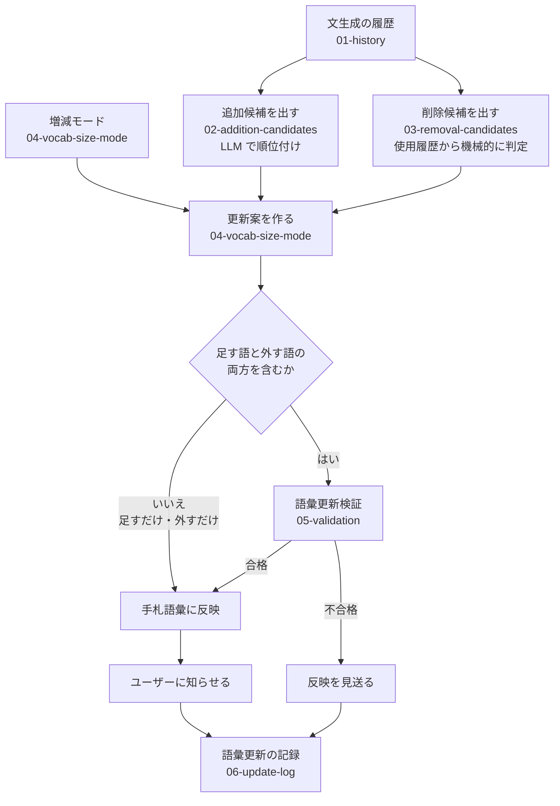

# 語彙更新（VocabOps）の設計

作成日：2026-10-18

文生成の履歴を分析し、その人が実際に言おうとしたことに合わせて、手札語彙を継続的に更新する仕組みの設計。用語は `../00-overview.md` の用語集に従う。

## 目的

- 手札語彙を、実際によく使う語を中心とした集まりに近づけていく。
- 新しく語を覚えるときに、自分にとって本当に必要な語を選べるようにする。
- 手札語彙の数は固定しない。増やしたいか・変えたくないか・減らしたいかは、ユーザーが増減モードで選ぶ。

## 全体の流れ

言語ごとに、文生成が一定回数行われるたびに、1回の語彙更新が自動で行われる。人間の承認はない。

1. 増減モードを確認する。
2. 追加候補と削除候補を出す。
3. 増減モードに合うように、更新案を作る。
4. 更新案が足す語と外す語の両方を含むときだけ、語彙更新検証を行う。
5. 検証が要らない更新案と、検証に合格した更新案は、自動で手札語彙に反映する。不合格なら見送る。
6. 手札語彙が変わったら、足した語・外した語をユーザーに知らせる。
7. 実行の内容を、反映したかどうかにかかわらず記録する。

語彙を増やす段階では成長を重視し、語彙数が頭打ちになってきたら、使われない語と有用な手札外語彙の語を交換して最適化を進める。

## 履歴の2つの使い道

文生成の履歴に出てきた語は、その文生成のときに手札語彙に含まれていたかどうかで、別々に数える。

| 場合 | 数える先 | 何を測るか |
|---|---|---|
| 手札語彙に**含まれる**語が、手札語彙文または拡張語彙文で使われた | 削除の判定用の使用回数（`03-removal-candidates.md`） | 今の手札語彙が、実際にどれくらい使われているか |
| 手札語彙に**含まれない**語が、拡張語彙文で使われた | 追加候補用の出現回数（`02-addition-candidates.md`） | 手札語彙にない語が、どれくらい必要とされているか |

どちらも、1回の文生成につき1回と数える（手札語彙文と拡張語彙文の両方に出ても、1つの文に何回出ても1回）。

語彙更新で使う回数（語彙更新の実行の間隔、手札語彙に入ってからの文生成回数、直近の使用回数など）は、通し番号の引き算ではなく、その時点で残っている文生成の数で数える。ユーザーが削除した文生成は、どの回数にも入らない（`../02-data-model.md` の 5.1）。

## ファイル

| ファイル | 中身 |
|---|---|
| `01-history.md` | 文生成のたびに記録するもの |
| `02-addition-candidates.md` | 追加候補の選び方 |
| `03-removal-candidates.md` | 削除候補の判定 |
| `04-vocab-size-mode.md` | 増減モードと、更新案の組み立て方 |
| `05-validation.md` | 語彙更新検証 |
| `06-update-log.md` | 語彙更新のたびに記録するもの |
| `parameters.md` | 調整できる数値の一覧。本文には数値を書かず、ここを指す |
| `experiments/` | 実験の記録（判定のぶれの測定など）。実験を始めるときに作る |

各ファイルは「何をするか」「入力と出力」「決まったこと」「未決」の順に書く。未決が決まったら「決まったこと」に移す。

## 基本の考え方

- **まずは単純な方法で作り、実際の履歴・費用・LLM の判定結果を見ながら、数値と方法を少しずつ調整する。**
- 細かい点数付けや、原文を意味の要素に分解することはしない。LLM にはできるだけ単純な比較や順位付けをさせる。
- LLM の判定にはぶれが残るので、改善がはっきりしないときは反映を見送る、保守的な仕組みを基本にする。

## 未決の一覧

各ファイルの「未決」をまとめたもの。

| 論点 | ファイル |
|---|---|
| 語彙更新検証に使う履歴の選び方（今は仮の方法） | 05 |
| 語彙更新検証の合格の基準の数値（今は仮の値） | 05、parameters |
| 比較判定のプロンプトと、提案語彙文の作り方の見直し | 05 |
| 直近の履歴と過去の履歴を、別々に集計して基準を変えるか | 05 |
| 足した語・外した語を、どの画面にどう知らせるか | 06（画面を作るときに決める） |
